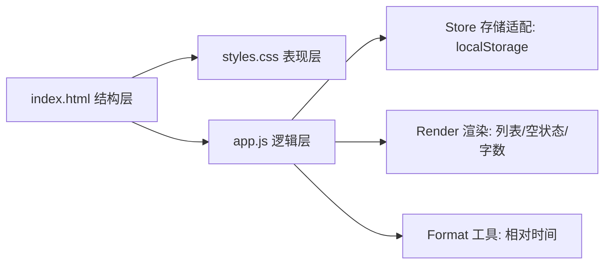

## Product Overview

「树洞 Tree Hole」是一个纯前端的匿名心事发布小站：用户在输入框写下内容并投递，页面按时间倒序展示所有留言。数据保存在浏览器本地，关闭后重新打开内容依然存在，双击 HTML 文件即可使用，无需服务器。

## Core Features

- **发布**：多行输入框 + 「投进树洞」按钮，空白内容不可提交，限制 300 字并实时显示字数，支持 Ctrl+Enter 快捷发布；发布成功后清空输入、卡片淡入并回到列表顶部。
- **浏览**：时间线以最新在前展示全部留言，每条显示匿名标识、正文（保留换行）与相对时间（刚刚 / x 分钟前 / x 小时前 / x 天前 / 具体日期）。
- **本地持久化**：数据写入浏览器 LocalStorage，刷新或重开页面数据不丢失；读取异常或数据损坏时自动降级为空列表，不出现白屏报错。
- **空状态与提示**：无内容时展示引导文案；存储不可用时给出柔和提示，不阻塞页面。
- **视觉**：清新森绿主题，圆角卡片、柔和留白、浅绿渐变背景，桌面与手机均自适应。
- **工程交付**：代码纳入 Git 版本管理，提供说明文档，并通过 SSH 推送到 GitHub 远程仓库。

页面与代码中不出现任何第三方社交平台名称，统一使用「树洞 / Tree Hole」。

## Tech Stack Selection

- 结构/样式/逻辑：原生 HTML5 + CSS3（自定义属性、Grid/Flex、过渡动画）+ 原生 JavaScript（ES6+，无构建、无框架、无 CDN）
- 数据存储：浏览器 `localStorage`（JSON 字符串序列化）
- 运行方式：直接双击 `index.html`，或用 Python/PowerShell 起静态服务验证
- 版本管理与交付：Git（Windows 版，`winget install Git.Git`）+ GitHub CLI（`winget install GitHub.cli`，用于自动建仓与登录授权）+ GitHub 远程仓库（SSH 协议，复用已有 `~/.ssh/id_ed25519`）

## GitHub 交付信息（已确认）

- 用户名：`tangguo0624`
- 提交邮箱：`13873189929@139.com`
- 仓库名：`tree-hole`（GitHub 不允许空格，由用户原意「tree hole」规范化）
- 现状：账号下公开仓库数为 0，**仓库不存在，需创建**
- 创建方式：`gh auth login --git-protocol ssh --web`（浏览器授权，并可自动上传公钥）→ `gh repo create tree-hole --public --source=. --push`
- 兜底：若浏览器授权不可用，则由用户在网页端创建空仓库并手动添加 `~/.ssh/id_ed25519.pub`，我再通过 SSH remote 推送

## Implementation Approach

采用「单页 + 三个文件」的最小分层：`index.html` 只负责语义结构，`styles.css` 负责主题与响应式，`app.js` 负责状态与渲染。核心策略是**内存状态为主、LocalStorage 为持久层**：

1. 启动时一次性读取并校验本地数据，得到内存数组 `posts`；渲染只读取内存，避免重复解析 JSON。
2. 发布时生成帖子对象（id 用 `crypto.randomUUID()`，降级为时间戳+随机数），`unshift` 到数组头部，先写存储再渲染，保证刷新与列表一致。
3. 渲染用 `DocumentFragment` 一次性拼装并替换列表节点；正文一律通过 `textContent` 写入，天然防 XSS。
4. 排序以 `createdAt` 写入顺序为准，只在加载时做一次 `sort` 兜底。

关键决策：

- **不引入框架/CDN**：作业要求纯原生，且需双击离线可用，Tailwind CDN 等外部依赖一律不用，主题全部手写 CSS 变量实现。
- **不做用户体系/点赞/搜索**：与确认的「严格最小可用」一致。
- **存储键带版本号**（`treehole.posts.v1`），便于后续迁移。

边界处理：

- `JSON.parse` 失败、非数组、字段缺失一律降级为空列表并 `console.warn`。
- `localStorage` 写入失败（隐私模式/配额）捕获后显示一次性提示条，不打断渲染。
- 时间显示为纯函数，避免时区依赖。

## Implementation Notes

- **环境前置**：`git` 未安装，先 `winget install --id Git.Git -e --source winget --accept-package-agreements --accept-source-agreements`，安装后重开终端或用绝对路径调用并验证 `git --version`。
- **身份配置**：`git config --global user.name tangguo0624`、`git config --global user.email 13873189929@139.com`。
- **SSH 推送**：`~/.ssh/id_ed25519` 已存在；`gh auth login` 选用 SSH 协议时可直接上传公钥，否则由用户手动粘贴 `id_ed25519.pub` 到 GitHub Settings。推送前用 `ssh -T git@github.com` 验证连通（返回 1 或 128 都属正常欢迎信息）。
- **分支与命名**：`git init -b main`；存储键、CSS 类前缀统一 `treehole`。
- **无破坏性变更**：工作区为空目录，仅新增文件；系统层变更仅安装 Git / GitHub CLI，执行前需用户确认。
- **验证方式**：浏览器自动化实际点击发布、刷新确认数据仍在并截图；若自动化环境不可用则改为本地静态服务 + 手动验证并如实说明。

## Architecture Design



- **Store**：`loadPosts()` / `savePosts()`，唯一读写 localStorage 的入口，负责校验与降级。
- **Render**：`renderList()` / `renderEmpty()` / `updateCounter()`，只做 DOM 更新。
- **Format**：`formatRelativeTime(ts)` 纯函数。
- **Controller**：`handleSubmit()` 串联「校验 → 建对象 → 存储 → 渲染 → 清空输入」。

## Directory Structure

```
20261113090241/
├── index.html                 # 页面结构：品牌头部、发布表单、时间线、空状态、页脚、Toast
├── assets/
│   ├── css/styles.css         # 森绿主题、渐变光斑、卡片、按钮态、淡入动画、响应式、减动效降级
│   └── js/app.js              # 存储/渲染/格式化/交互，textContent 防注入
├── README.md                  # 功能、运行方式、数据结构、作业要求对应说明
└── .gitignore                 # Thumbs.db、.DS_Store、.vscode/、*.log 等
```

## Key Code Structures

```js
// localStorage key: "treehole.posts.v1"，值为按 createdAt 倒序的数组
{ id: string, content: string, createdAt: number }
```

## 页面规划

单页应用（移动优先，容器最大宽度 680px 居中）：

1. **品牌头部**：手绘感叶片 SVG + 「树洞 · Tree Hole」，副标题「把心事说给树听」；右侧胶囊显示洞里的声音条数。
2. **发布卡片**：白色圆角卡片，无边框多行输入（占位「这里没有熟人，说说今天的事……」），底部左为 `0 / 300` 计数（超限变橙红），右为渐变胶囊按钮「投进树洞」（hover 上浮 + 光晕，禁用态降饱和）。
3. **时间线区**：小标题「洞里的声音」+ 右侧灰字「最新在前」+ 极淡虚线分隔。
4. **留言卡片**：左侧 44px 圆形匿名标识（绿色渐变 + 叶脉），右上相对时间，正文深墨绿保留换行，hover 微移 + 阴影加深，进入自下而上淡入。
5. **空状态**：纯 CSS 树影轮廓 + 飘落叶片，文案「这里还很安静，说第一句吧」。
6. **页脚**：内容仅保存在此设备浏览器中 / Tree Hole · 原生 HTML / CSS / JavaScript。

## 交互与动效

提交后卡片 240ms 淡入上移、输入清空并聚焦、平滑回顶；字数超限按钮禁用并提示；动效仅用 transform/opacity，遵循 `prefers-reduced-motion`；移动端（<480px）内边距收窄、按钮撑满、字号下调。

## Skill

- **playwright-cli**：打开本地页面，执行「输入 → 投进树洞 → 刷新」验证发布、倒序与持久化并截图（桌面/移动/空状态）。若本机缺少 Node 导致不可用，则回退为本地静态服务 + 手动截图验证。